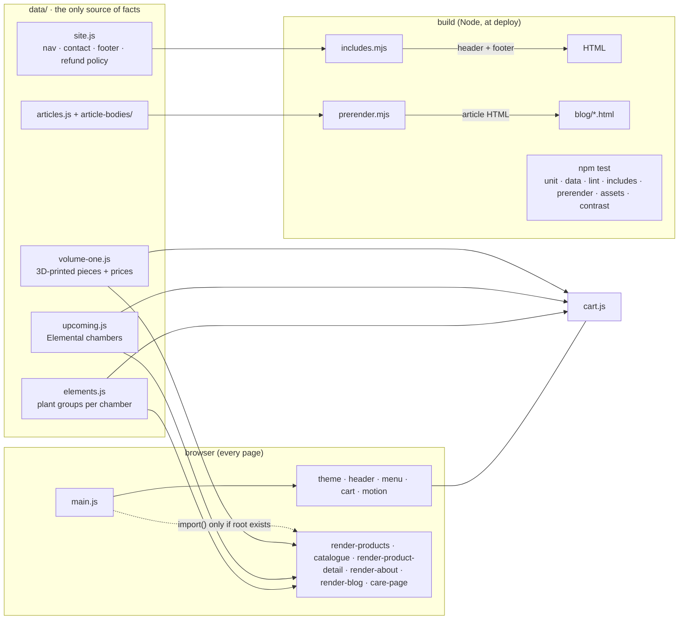

# EarthBox · Site

**TL;DR:** ***Plain HTML + ES modules, no framework, no bundler, deployed on Vercel from `main`. Everything the site says comes from `data/`. A short build step stamps the shared header/footer and the Journal articles into static HTML, then runs the checks. Any failing check blocks the deploy.***

Live: https://www.earthbox.in · Repo: github.com/ozapravar-crypto/earthbox-site · Issues: beads (`bd ready`, prefix `site-`)

---

## Run it

```bash
npm install                 # also turns on the pre-push hook (.githooks/pre-push)
python3 -m http.server 8080 # then open http://localhost:8080 (modules need a server, not file://)
npm run build               # what Vercel runs: includes → prerender → npm test
npm run test:e2e            # browser smoke tests, desktop + phone (needs Playwright's Chromium)
```

Before pushing anything that changes the UI, run `npm run test:e2e`. The pre-push hook runs `npm test` automatically.

## Architecture map



| Layer | Files | Owns | Never does |
|---|---|---|---|
| **Data** | `data/*.js` | Every product, price, plant group, article, nav link, phone number | Touch the DOM |
| **Pure rules** | `care.js`, `pairings.js`, the rule half of `cart.js`, `util.js` | Decisions (what fits, what it costs, what matches), each with a `*.test.mjs` | Touch the DOM |
| **Renderers** | `render-*.js`, `catalogue.js`, `care-page.js`, the UI half of `cart.js` | Turning data into markup, wiring clicks | Hold facts of their own |
| **Motion** | `reveal`, `scramble`, `magnetic`, `cursor`, `parallax`, `pin`, `loader`, `manifesto-spotlight` | Behaviour only (spec: `MOTION.md`) | Change content |
| **Build + checks** | `includes.mjs`, `prerender.mjs`, `check-*.mjs` | Static HTML for crawlers; the deploy gate | Run in the browser |
| **Styles** | `tokens.css` (all colours/fonts/spacing) → `reset`/`typography`/`primitives`/`components` (every page) → one file per page | Look | Hard-code colours (use tokens) |

Feature docs: **`CART.md`** (cart + saved list, two kinds of line) · **`MOTION.md`** (motion rules per section) · **`_audits/`** (dated audits and what was fixed).

## The checks

| Command | On deploy | Fails when |
|---|---|---|
| `npm run test:unit` | ✓ | Cart/care/form rules break, or **data shape** is wrong (`data.test.mjs`) |
| `npm run lint` | ✓ | Correctness, not style. Core: unused/undefined names, `==`, `var`, stray `console.log`. Type-aware (typescript-eslint): promises left unhandled, conditions that can't be false, casts that do nothing, `[object Object]` in text. Any warning or stale `eslint-disable` fails |
| `npm run typecheck` | ✓ | TypeScript in strict mode finds a type error in the JavaScript (`tsconfig.json`: `checkJs`, no compiling, the site ships as written). Types come from inference + JSDoc; the vendored libraries are typed by the `.d.ts` beside them |
| `npm run check:unused` | ✓ | knip: an unused file, export or dependency |
| `npm run check:dupes` | ✓ | jscpd: a copy-pasted block of 50+ tokens (`.jscpd.json`, threshold 0) |
| `node scripts/includes.mjs --check` | ✓ | A page's header/footer differs from `data/site.js` |
| `npm run check:prerender` | ✓ | An article page has no `<h1>`, too little text, or duplicated sections |
| `npm run check:assets` | ✓ | Any `src`/`href`/product photo/illustration points at a missing file |
| `npm run check:contrast` | ✓ | A text colour token falls below 4.5:1 on `--bg` or `--bg-tint`, light or dark |
| `npm run test:e2e` | — (no browser on Vercel) | A page errors, 404s or scrolls sideways; a fixed bug comes back |
| `npm run qa:contrast` | CI (GitHub Actions) | Any text, placeholder, icon or focus ring under WCAG AA on any page × theme × size × state, measured from real pixels (see `qa/CONTRAST.md`) |
| `.github/workflows/qa.yml` | every push / PR | Runs `npm test`, the Playwright suite (incl. `tests/contrast.spec.mjs`) and the full contrast audit; reports are uploaded as artifacts |

## How to…

**Add or change a 3D-printed product** (`data/volume-one.js`)
1. Add an entry. The shape is in the JSDoc at the top of the array. `pricing: null` means "price on enquiry"; a price table makes it "ready to order" in the cart.
2. Put `name.webp`, `name-600.webp` and `name-300.webp` in `assets/v1/` (plants go in `assets/plants/`).
3. Run `npm test`. `data.test` checks the shape and `check-assets` checks the photos.

**Add a Journal article**
1. Add its body to the right `data/article-bodies/*.js` and its entry to `data/articles.js`.
2. Copy any `blog/*.html` to `blog/<slug>.html` and set `<body data-article="<slug>">`.
3. Run `npm run build`. It writes the article and header/footer into the page, then checks it. Add the URL to `sitemap.xml`.

**Add a botanical drawing** (`assets/illustrations/`)
1. Generate it in the engraved style with a print-kit plate as the style reference (black ink on white, no frame, nothing touching the edges), and keep the original PNG in `earthbox-print/img/site-art/`.
2. Turn it into an **ink mask**: 480 × 480 WebP, black pixels, alpha = ink density, cropped to the drawing. CSS paints it in `currentColor`, so one file works in light mode, dark mode and the inverted "selected" state.
3. Add its entry to `assets/illustrations/manifest.json`. Use it with `art('<id>')` (`scripts/util.js`).
4. Run `npm test`. `check-assets` fails if any `art()` id, `answerArt` entry or `--art:url()` points at a missing file.

**Change the nav, contact details, footer or refund policy**
Edit `data/site.js`, then `npm run build`. All 29 pages update; the mobile menu reads the same `NAV`.

**Add a page**
Copy the closest page (keep the `<header class="runhead">` and `<footer class="colophon">` blocks; `includes.mjs` fills them). If it needs JS, add its root selector and module to `PAGE_MODULES` in `scripts/main.js`. Add it to `NAV` if it belongs in the menu.

**Change a colour**
Only in `styles/tokens.css`, for both light and dark. `check:contrast` tells you if text stops being readable.

## Standards (enforced, not just written down)

- **One source per fact:**
  - prices and products: `data/`
  - contact, nav and footer: `data/site.js`
  - colours: `tokens.css`
  - the photo folder: `photoPath()`

  Don't retype a number that already lives somewhere.
- **Types, not comments.** New code passes `npm run typecheck` with no `any`, `@ts-ignore` or `@ts-nocheck`; `@ts-expect-error` only with a reason. Data shapes are inferred from `data/` and imported as `@typedef`s (`Product`, `Plan`, `Line`, …), not retyped.
- **No dead or duplicate code.** knip and jscpd run in `npm test`; delete instead of commenting out.
- **Pure rules get a test.** Anything that decides (fits, costs, matches, parses untrusted input) lives in a DOM-free function with a `*.test.mjs`.
- **Untrusted input is validated at the edge.** URL hashes and localStorage go through `decodePlan` / `clean()`, which keep known ids only.
- **Page code loads only where it's used** (`PAGE_MODULES`).
- **Static where crawlers look.** Header, footer and articles are real HTML at deploy time.
- **Accessibility floor:** 44 px tap targets, visible focus, `prefers-reduced-motion` honoured, text ≥ 4.5:1, a skip link on every page.
- **Design rules:** site tokens, sharp rectangular edges (the homepage hero's round arrow is the one agreed exception), and checks at 1440 / 375 px plus dark mode.
- **Don't fake data.** A missing price stays "on enquiry"; a missing product photo is an issue in beads (see `KNOWN_MISSING` in `check-assets.mjs`).
- **Generated art is tagged, never passed off.** Every AI-generated image has an entry in its folder's `manifest.json` (prompt, model, style reference, date, `"source": "AI-generated illustration"`). Botanical drawings are decorative (`aria-hidden`); the words beside them carry the meaning. Rules: `earthbox-iconography-audit.md` §7.6.
- **Bugs get a regression test.** When fixing one, add the check that would have caught it (see `tests/smoke.spec.mjs`).

## Deploy

Push to `main` and Vercel runs `npm run build`. If any check fails, the previous version stays live. Pushes use the `ozapravar-crypto` GitHub account.
